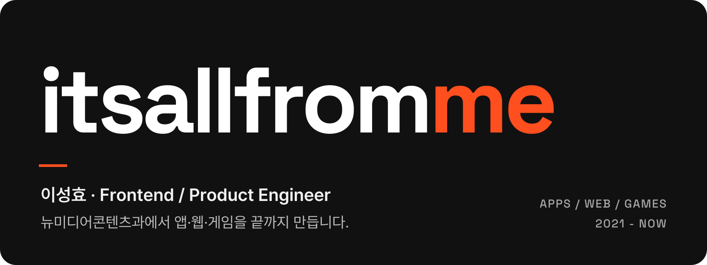
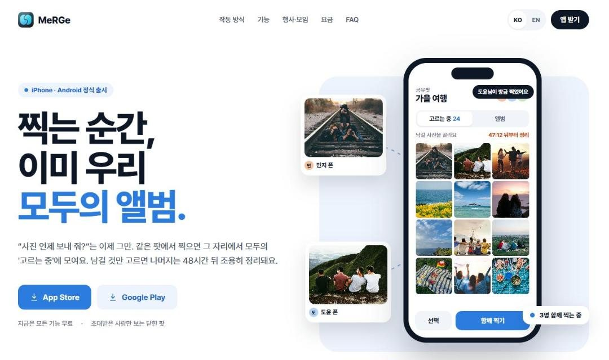
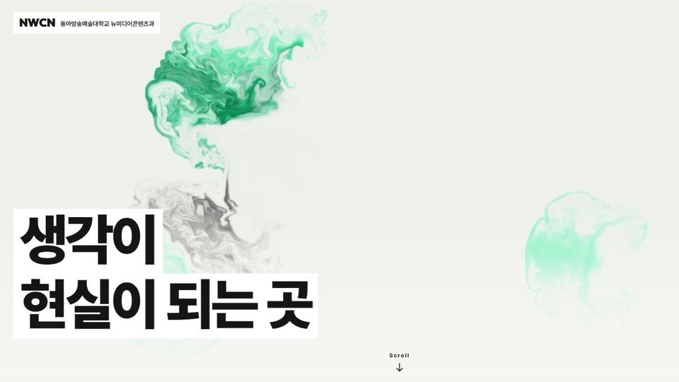
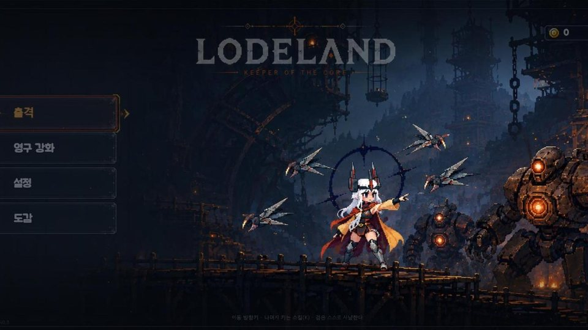
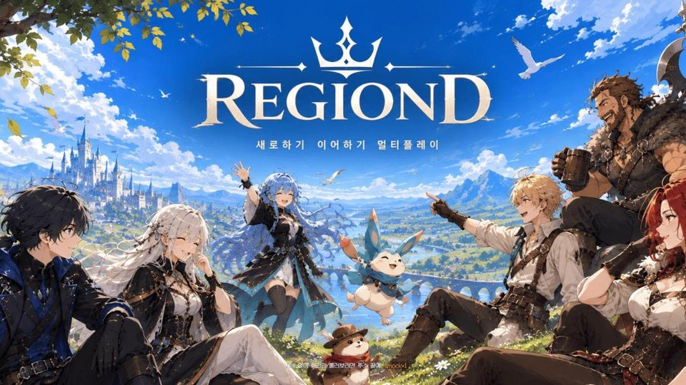
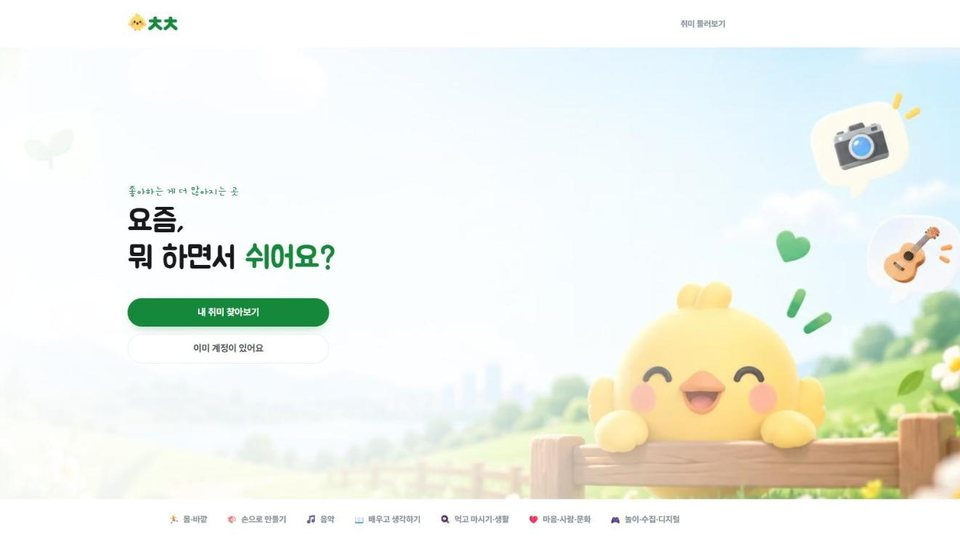
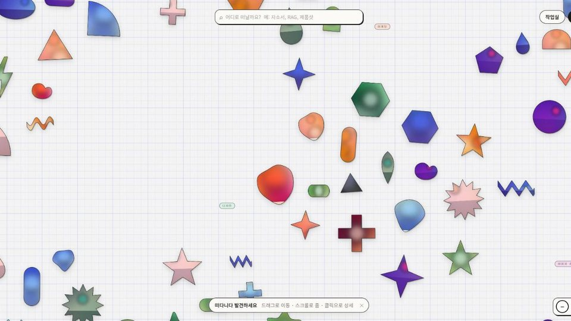
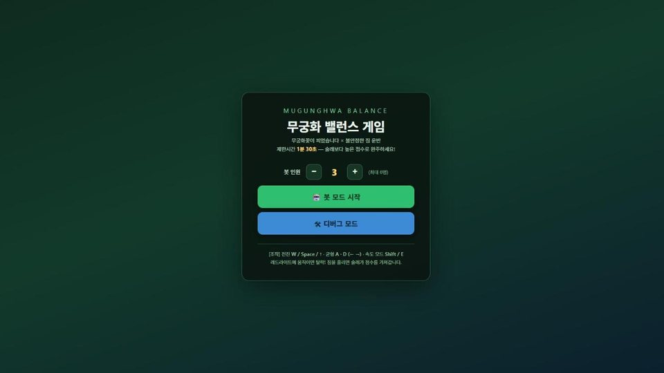

  

문제의 원인을 끝까지 찾아서, 구조를 바꿔 해결하는 개발자입니다.
화면부터 DB·배포·운영까지 혼자 끝까지 만드는 일을 가장 많이 해 왔습니다.

 

### [MeRGe](https://letsmerge.app) | 그룹 실시간 공유 카메라
같은 자리에서 각자 찍은 사진이 바로 모두의 앨범에 모이는 카메라 앱입니다. App Store와 Google Play에 출시했고, 앱·백엔드·대시보드·운영 콘솔을 혼자 개발했습니다. 팀 조직 저장소라 코드는 비공개입니다.

 

<table>
  <tr>
    <td width="50%" valign="top">
      
      <h3><a href="https://github.com/dudejrtjdrp/NCWNWeb">NWCN</a></h3>
      동아방송예술대학교 뉴미디어콘텐츠과 공식 웹사이트입니다. 관리자 CMS를 만들어 담당자가 바뀌어도 코드 수정 없이 콘텐츠를 올리고 고칠 수 있게 했습니다. 
      4인 팀 팀장 · 개발 1인 · Next.js · Supabase · Cloudflare R2 · <a href="https://www.dima-nwcn.com">dima-nwcn.com</a>
    </td>
    <td width="50%" valign="top">
      
      <h3><a href="https://github.com/dudejrtjdrp/LodeLand">LODELAND</a></h3>
      길들인 검 무리가 알아서 적에게 날아가 싸우는 서바이버류 웹 액션 게임입니다. 후반 라운드 프레임 저하를 계측해 화면 밖 오브젝트가 원인인 걸 찾고 구조를 바꿔 해결했습니다. 
      1인 개발 · Phaser 3 · TypeScript · Playwright · <a href="https://lodeland.pages.dev">플레이하기</a>
    </td>
  </tr>
  <tr>
    <td width="50%" valign="top">
      
      <h3><a href="https://github.com/dudejrtjdrp/regiond">Regiond</a></h3>
      1~5명이 함께 정착지를 키우고 몰려오는 적을 막는 멀티플레이 웹게임입니다. 게임 판정을 서버 한곳에 모으고 같은 조건이면 같은 결과가 나오게 만들어, 밸런스를 바꿀 때마다 시뮬레이터로 바로 확인할 수 있게 했습니다. 
      NHN 게임 공모전 · 1인 개발 · Node.js · Socket.IO · Canvas
    </td>
    <td width="50%" valign="top">
      
      <h3><a href="https://chick-hobby.vercel.app">ㅊㅊ | 취미 찾기 AI</a></h3>
      요즘 어떻게 쉬는지 물어보고 맞는 취미를 찾아 주는 AI 서비스입니다. LLM이 없는 링크를 지어내지 않도록 검색 후보 안에서만 고르게 하고, 서버가 링크 접속을 확인합니다. 
      원티드 AI 챔피언십 · Next.js · Supabase · HyperCLOVA X
    </td>
  </tr>
  <tr>
    <td width="50%" valign="top">
      
      <h3><a href="https://github.com/dudejrtjdrp/ykk-web">ykk</a></h3>
      검증된 AI 프롬프트와 워크플로우를 사고파는 마켓 MVP입니다. 무한 캔버스에서 둘러보고, Before/After와 재현률을 확인한 뒤 고를 수 있게 했습니다. 
      기획·프론트엔드 1인 · Next.js · Framer Motion
    </td>
    <td width="50%" valign="top">
      
      <h3><a href="https://github.com/dudejrtjdrp/redLightGreenLight">무궁화 밸런스 게임</a></h3>
      '무궁화 꽃이 피었습니다'에 흔들리는 짐 운반을 더한 3D 웹 파티게임입니다. 빨리 가면 멈출 때 짐을 흘리고, 천천히 가면 시간이 모자라는 고민을 규칙 하나로 만들었습니다. 
      NHN AI GAME HACKATHON · 2인 팀, 게임플레이·시스템 개발 전체 · Three.js
    </td>
  </tr>
</table>

### 지금 만들고 있는 것

<table>
  <tr>
    <td width="50%" valign="top">
      <b>Ordo</b> 비공개 · 데스크톱 v0.3.0 
      팀의 코드·작업·회의를 한곳에 모으고, 쌓인 기록을 근거로 질문에 답하는 팀 운영 데스크톱 앱입니다. 창업 워크플로우 도구 SOS를 이어서 만들고 있습니다.
    </td>
    <td width="50%" valign="top">
      <b><a href="https://github.com/dudejrtjdrp/wooyeon-table">우연한 식탁</a></b> 
      처음 만나는 4~6명을 한 테이블로 이어 주는 소셜다이닝 서비스 MVP입니다. 신청부터 매칭·결제·식당 안내까지 운영자 손 없이 돌아가게 만들었습니다.
    </td>
  </tr>
  <tr>
    <td width="50%" valign="top">
      <b><a href="https://github.com/dudejrtjdrp/Mealing">Mealing</a></b> TestFlight 테스트 중 
      외식·편의점 메뉴를 고를 때 오늘 섭취량 기준으로 먹어도 되는지 알려 주는 식단 관리 iOS 앱입니다. 창업공모전 팀에서 앱 설계·개발을 맡았습니다.
    </td>
    <td width="50%" valign="top">
      <b>혼재</b> 졸업전시 
      언리얼 엔진으로 만드는 3:3 FPS 게임입니다.
    </td>
  </tr>
</table>

그 밖에 [souless](https://github.com/dudejrtjdrp/souless)(3주 동안 혼자 완성한 2D 횡스크롤 액션 게임), [planProject](https://github.com/dudejrtjdrp/planProject), [test_keyboard](https://github.com/dudejrtjdrp/test_keyboard), [Bosung](https://github.com/dudejrtjdrp/Bosung)(WebXR 3D 뷰어)도 있습니다.

### 경력

- **화이트블록** | itsme.id 엔터프라이즈 관리자 웹 Frontend 단독 (2021.12 ~ 2022.10, 서비스 유저 0 → 5만 명 구간)
- **동아방송예술대학교 뉴미디어콘텐츠과** | 2027년 2월 졸업 예정

### 기술

TypeScript · React · Next.js · React Native(Expo) · Angular · Tailwind CSS · Supabase(PostgreSQL · RLS · Edge Functions) · Cloudflare R2 · Vercel · Phaser · Three.js · Jest · Playwright · Claude Code · Codex

### 연락

[dudejrtjdrp@naver.com](mailto:dudejrtjdrp@naver.com) · [dudejrtjdrp@gmail.com](mailto:dudejrtjdrp@gmail.com)
